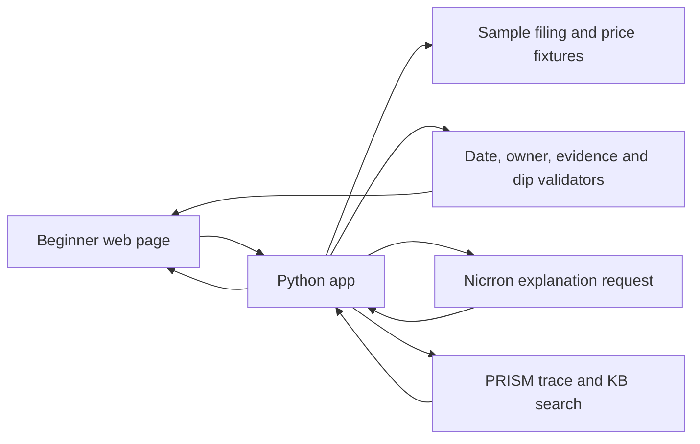
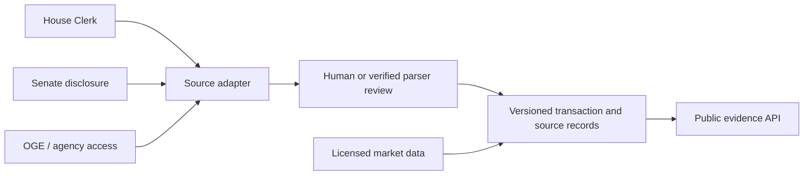

# Architecture: source-grounded transaction explainer

**Prototype shape:** one small server-rendered Python web app, local JSON fixtures, Nicrron model call, and PRISM HTTP/KB integration. Server-side credentials only. No database or scheduled ingestion in the hackathon build.

## Boundaries

- **Fixture store:** JSON plus a sample `.md` filing. All names, transactions, and prices are fictional and marked as samples. The sample filing is uploaded to PRISM KB and assigned to the app's agent ID. A local sample document path is not a real official URL.
- **Validation:** a pure function checks schema, amount range, chronology, evidence row and hash. A missing or contradictory field produces `needs_review`, not a confident card. A price function uses `Decimal`, a reference price greater than zero, explicit threshold/window, and timestamp.
- **Explanation and voice:** backend submits the selected row, optional user question, and KB result to Nicrron using its OpenAI-compatible endpoint and the pinned `openai/gpt-4o-mini` model. The model selects one of five topics (`OWNER`, `TIMING`, `AMOUNT`, `PRICE`, `SOURCE`); the backend renders an answer from validated sample fields. Any other model output is discarded. The browser optionally transcribes a spoken question and speaks the answer with Web Speech APIs; text input and visible text output remain available. The factual transaction summary is deterministic, so the model cannot add an unsupported trade claim, set trade status, or set watch-event state.
- **PRISM:** use a fixed `agent_id` and stable `session_id` per demo run. Call KB search before the model and include its result as retrieval/tool context in the trace or SDK span so judges can see it. Record input, output, model, latency, and the retrieval step. Never mark local logs as proof of hosted PRISM receipt.
- **UI:** three cards, evidence drawer, explanation, formula, and data limitations. Color does not alone carry meaning; dates and status use text. The “watch” threshold is a demo parameter, not a recommendation.

## Future real-data path

Each source adapter needs its own access/terms review. [House](https://disclosures-clerk.house.gov/FinancialDisclosure/ViewSearch), [Senate](https://www.senate.gov/legislative/Public_Disclosure/financial-disclosure.htm), and [OGE](https://www.oge.gov/Web/OGE.nsf/publicresources_disclosure-quickstart?OpenForm=&Seq=1) have different search and access methods. There is no assumed unified government trade API. Do not scrape through access gates, CAPTCHAs, or rate limits; stop and seek an authorized path. Preserve original document URL, retrieval timestamp, hash, parser version, reviewer, and amendments.

## API shape (future or local routes)

- `GET /api/sample/transactions`: validated fixture summaries.
- `GET /api/sample/transactions/{id}`: full source-linked record and limitations.
- `POST /api/sample/explain`: selected fixture ID only; no arbitrary source URLs or client-supplied credentials.
- `GET /api/sample/watch/{id}`: deterministic price reference, observed price, and calculation.

The public API must expose explicit status and timestamps. A reported transaction can be `sample`, `verified_source`, `needs_review`, `corrected`, or `withdrawn`; only `verified_source` may appear as a real filing claim. `sample` always has a demo banner. Rate-limit model calls; redact credentials and user input from logs. Review whether raw disclosure excerpts may be redistributed before a real-data release.
